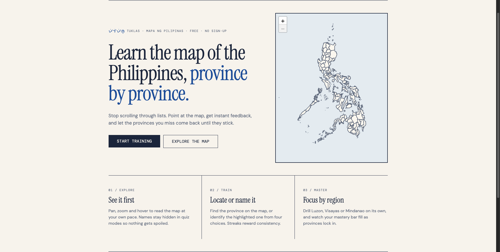

# Tuklas Pilipinas

**Learn the map of the Philippines, province by province.**

Tuklas Pilipinas (_tuklas_ means "to discover") is an interactive geography trainer that helps you memorize where every Philippine province is. It runs entirely in the browser: no account, no backend.

**[Live demo](https://tuklas-pilipinas.vercel.app)**



## Features

- **Interactive map.** Pan, zoom and tap provinces on a Leaflet map built from GeoJSON boundaries.
- **Learn, then test yourself.** Explore the provinces first, then practice recalling them.
- **Instant feedback.** Correct and wrong answers are shown right away, with a small celebration when you do well.
- **Works on desktop and mobile.** Responsive layout built with Tailwind CSS.
- **Fast and static.** A single-page app with client-side routing, deployed on Vercel.

## Getting started

You need [Node.js](https://nodejs.org) (a current LTS version) and [pnpm](https://pnpm.io).

```bash
# clone the repository
git clone https://github.com/Sanjero20/tuklas-pilipinas.git
cd tuklas-pilipinas

# install dependencies
pnpm install

# start the dev server
pnpm dev
```

Then open the local URL that Vite prints (usually `http://localhost:5173`).

### Scripts

| Command        | What it does                                                   |
| -------------- | -------------------------------------------------------------- |
| `pnpm dev`     | Start the Vite dev server with hot reload                      |
| `pnpm build`   | Type-check with `tsc` and create a production build in `dist/` |
| `pnpm preview` | Preview the production build locally                           |
| `pnpm lint`    | Run ESLint                                                     |

## Data

Province boundaries come from this [Repository](https://github.com/bendlikeabamboo/barangay-boundaries-repository/releases/tag/v2026.4.13.0) GeoJSON data derived from official PSA/NAMRIA boundaries.

## Deployment

The app is deployed on Vercel. `vercel.json` rewrites all routes to `index.html` so direct links to client-side routes work. To deploy your own copy, import the repository in Vercel; the default Vite settings (`pnpm build`, output `dist`) are all you need.

## Contributing

Issues and suggestions are welcome. If you find a wrong or outdated province boundary, please open an issue with the correct source.

## Author

Made by [Sanjero20](https://github.com/Sanjero20).
